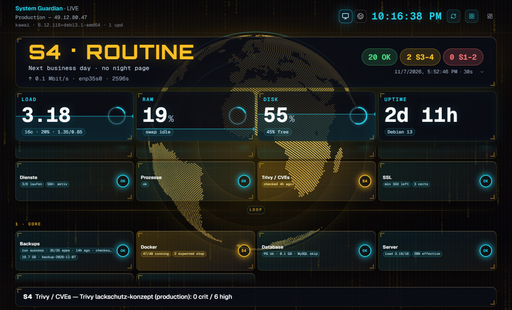

# System Guardian

Überwacht Linux-Server per SSH (ohne Pflicht-Agent). Health, Docker, RAID, Backups, SSL, Logins und mehr. Coolify ist optional. Optionaler Metrics-Agent für Live-Werte auf `/monitor`.



Passt neben [Beszel](https://github.com/henrygd/beszel) (Metriken) und [Uptime Kuma](https://github.com/louislam/uptime-kuma) (Erreichbarkeit) — Guardian macht die Ops-/Security-Checks.

## Start (Docker)

```bash
cp .env.example .env
docker compose up --build
```

Dann http://localhost:3000 öffnen → **Einstellungen → Server** → Host + SSH eintragen.

Für Produktion in `.env` setzen: `AUTH_SECRET`, `AUTH_USERNAME`, `AUTH_PASSWORD`, `CRON_SECRET`.

## Lokal (Windows)

```powershell
Copy-Item .env.example .env.local
# DATABASE_URL auf lokales PostgreSQL setzen, CHECK_MODE=mock
npm install
npm run db:migrate
npm run db:seed
npm run dev
```

## Mehr

| | |
|--|--|
| Deploy / Cron | [docs/DEPLOY.md](docs/DEPLOY.md) |
| Coolify | [docs/COOLIFY.md](docs/COOLIFY.md) |
| Ops-Handbuch | [docs/SYSADMIN.md](docs/SYSADMIN.md) |
| Mitmachen | [CONTRIBUTING.md](CONTRIBUTING.md) |

MIT — [LICENSE](LICENSE)
